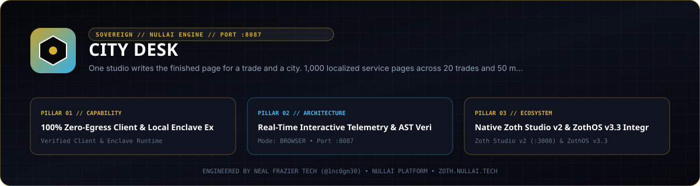

<div align="center">
  
</div>

<br />

<div align="center">
  <a href="https://zoth.nullai.tech/tools/city-desk"></a>
  <a href="https://zothos.nullai.tech"></a>
  <a href="https://nullai.tech"></a>
</div>

# ⚡ City Desk

> **One studio writes the finished page for a trade and a city. 1,000 localized service pages across 20 trades and 50 mid-size cities with live customizer, multi-mipmap ICO, Pro bundle export, and dual Stripe + Solana checkout rails.**

---

## 🏛️ Architectural Overview

**City Desk** is an official sovereign tool in the **[Zoth Studio v2](https://zoth.nullai.tech)** (71-Tool Matrix) and **[ZothOS Linux 3.3](https://zothos.nullai.tech)** ecosystem, engineered by **Neal Frazier Tech ([@1nc0gn30](https://github.com/1nc0gn30))**.

| Property | Specification |
| :--- | :--- |
| **Tool ID** | `city-desk` |
| **Category** | `Growth & SEO` |
| **Loopback Port** | `http://127.0.0.1:8087` |
| **Execution Mode** | `browser` |
| **Zoth Studio Route** | [`https://zoth.nullai.tech/tools/city-desk`](https://zoth.nullai.tech/tools/city-desk) |

---

## 💎 Key Capabilities

- **100% Zero-Egress Client & Local Enclave Execution**
- **Real-Time Interactive Telemetry & AST Verification**
- **Native Zoth Studio v2 & ZothOS v3.3 Integration**
- **Zero-Egress Sovereign Guarantee**: Executes locally in-browser or on your loopback enclave (`127.0.0.1:8087`) with zero cloud telemetry.
- **Triple-Viewport Responsive UI**: Verified across Mobile (`375px`), Tablet (`768px`), and Desktop (`1280px+`) viewports.

---

## 🚀 Quick Start

```bash
# Launch via CLI or Zoth Fleet Supervisor
cd ~/NullAITech/city-desk && npm start

# Or supervise the entire 73-port fleet from Zoth Studio v2:
python3 ~/NullAITech/zoth-studio-v2/bin/ensure_fleet.py
```

---

<div align="center">
  <sub>Engineered by <b>Neal Frazier Tech</b> (<a href="https://github.com/1nc0gn30">@1nc0gn30</a>) &bull; <a href="https://nullai.tech">NullAI Platform</a> &bull; <a href="https://zoth.nullai.tech">Zoth Studio v2</a></sub>
</div>
